# Laboratorio 3: Transporte

Análisis de flujo y congestión de redes utilizando simulación de eventos discretos.

## Integrantes:

- Tomas Ponce
- Franco Molina
- Victoria Lopez

## Introducción:

Estudiaremos los problemas de Control de Congestión y Control de Flujo. El primero se encarga del control de tráfico de paquetes en la red, su objetivo es evitar que los nodos intermedios entre hosts colapsen y se pierdan paquetes de datos mientras que el control de flujo se encarga de controlar la cantidad de datos transmitidos para no saturar al receptor de dichos datos.

Para estudiar estos problemas analizaremos una red simple que contiene dos módulos NodeTx y NodeRx conectados por un nodo intermedio en una red

**NodeTx**: Tiene un generador y una buffer, el generador basicamente genera paquetes cada un cierto tiempo y la cola se encarga de ir mandando paquetes a medida que va pudiendo y cuando no puede los almacena en el buffer hasta poder hacerlo.

**NodeRx**: Tiene un consumidor y una cola, el consumidor consume los paquetes a una cierta velocidad y la cola se encarga de recibir los paquetes y almacenarlos en el buffer hasta que el consumidor los consuma y si se llena descarta los nuevos paquetes que llegan y no entran.

**Cola Intermedia**: Es como un router, que recibe mensajes de una de su entrada y los envía a la salida a medida que va pudiendo. Cuenta con un buffer para almacenar los paquetes cuando le llegan a más velocidad de la que los puede mandar y que cuando se llena, la cola descarta los nuevos paquetes que van llegando.

En base a la red planteada anteriormente se pueden ver varios problemas de Congestion y Control de Flujo para ciertas redes cuyas velocidades de transmision varian. Para solucionar este problema vamos a plantear la siguiente red:

Basicamente agregamos un canal de retorno desde NodeRx a NodeTx para que el receptor informe al transmisor para que regule la tasa de transmisión. A su vez, la Cola Intermedia podra enviar paquetes de Feedback al receptor para avisar de congestion, el cual reenviara dichos paquetes al transmisor para que reduzca la velocidad de transmision.

## Casos de Estudio:

Para los casos de estudio analizamos el impacto de la tasa de transmisión y tamaño de buffers en el tráfico de red y veremos los problemas que surgen a partir de esto.

### Caso de estudio 1:

Para este caso de estudio vamos a tener:

- De NodeTx a la Cola Intermedia una velocidad de datos de 1 Mbps y una demora de 100 us
- De la Cola Intermedia a NodeRx una velocidad de datos de 1 Mbps y una demora 100 us
- De NodeRx a Sink una velocidad de datos de 0.5 Mbps

### Caso de estudio 2:

- De NodeTx a la Cola Intermedia una velocidad de datos de 1 Mbps y una demora de 100 us
- De la Cola Intermedia a NodeRx una velocidad de datos de 0.5 Mbps y una demora de 100 us
- De NodeRx a Sink una velocidad de transmisión 1 Mbps

## Experimentos de Análisis y sus Resultados

### Casos de estudio 1 (Primera Fila) y 2 (Segunda Fila) con distribución exponencial(λ=0.1):

| Tamaño de buffers | Paquetes eliminados | Delay de paquetes |
| ----------------- | ------------------- | ----------------- |

| 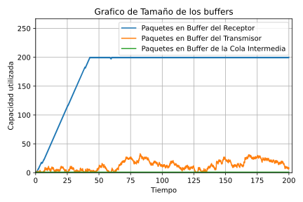 | 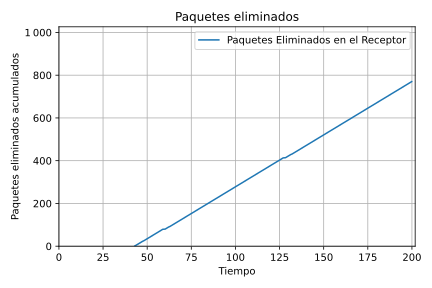 | 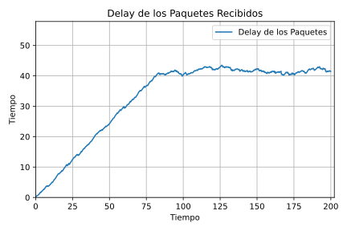 |
| ------------------------------------------------------------------------------------- | --------------------------------------------------------------------------------- | ----------------------------------------------------------------------------------------------- |

| 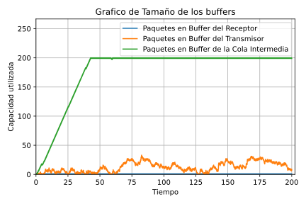 | 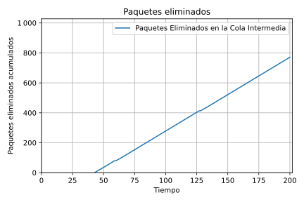 |  |
| ------------------------------------------------------------------------------------- | --------------------------------------------------------------------------------- | ----------------------------------------------------------------------------------------------- |

### Caso de Estudio 1 y 2:

Se puede observar en ambos casos de estudio que se intercambian las situaciones del Buffer Receptor con el Buffer de la Cola Intermedia y como la cantidad de paquetes en el Buffer del Transmisor se mantiene igual en ambos casos. Esto sucede asi ya que en el Caso 1 la Cola Intermedia tiene una tasa de transferencia desde al NodeRx de 1 Mbps, el doble que la tasa de transferencia de NodeRx a Sink. Aquí observamos un cuello de botella, y esto genera un problema de control de flujo: Una red rápida alimenta a un receptor con capacidad pequeña.

Ahora, el hecho de que en el caso 2 sea la Cola Intermedia quien se llena y el Buffer del Receptor quien se mantiene en niveles bajos es porque justamente la diferenciación entre ambos casos de estudio es la velocidad de la salida de dichos nodos, causando que el cuello de botella simplemente se haga en otro lado pero sea el mismo. La Cola Intermedia recibe de NodeTx a 1Mbps, y le envía a NodeRx a 0,5 Mbps, haciendo que reciba 0.5 Mbps mas de lo que puede transmitir hacia adelante, llenando asi su capacidad de buffer eventualmente. Aquí está el cuello de botella que genera un problema de congestión: Se transmiten paquetes a una tasa que la red no puede manejar, y por ende se pierden paquetes que nunca llegarán al receptor (cuya capacidad sería suficiente para recibir todos los paquetes).

### Casos de estudio 1 (Primera Fila) y 2 (Segunda Fila) con distribución exponencial(λ=0,3):

| Tamaño de buffers | Delay de paquetes |
| ----------------- | ----------------- |

| 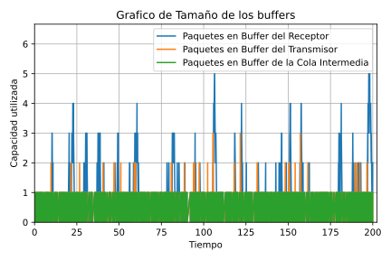 | 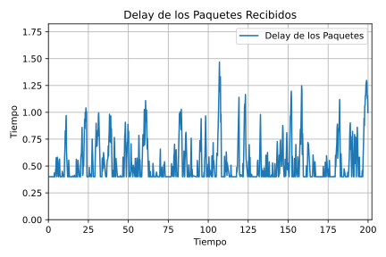 |
| ------------------------------------------------------------------------------------- | ----------------------------------------------------------------------------------------------- |

| 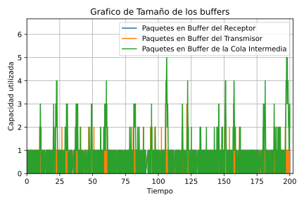 |  |
| ------------------------------------------------------------------------------------- | ----------------------------------------------------------------------------------------------- |

### Caso de Estudio 1 y 2:

En estos casos, al aumentar a λ=0,3 la tasa de generacion de paquetes es mucho menor, haciendo que no se usen tanto recursos de red. Consecuencia de esto es que nunca se llegan a llenar los buffers, dado que las velocidades de transferencia son suficientes para transmitir los paquetes a medida que llegan. Gracias a esto no hay perdida de paquetes por congestion ni hay necesidad de control de flujo.

Análogamente, esto va a seguir sucediendo a medida que aumentamos el valor de λ dado que si ya la red esta sobrada entonces aumentando el tiempo en el que se generan los paquetes solo va a hacer que la red siga sin ninguna carga significativa.

Habiendo analizado estos casos, nos interesa resolver las situaciones para λ=0,1 donde tenemos para el caso de estudio 1 un problema de control de flujo y para el caso de estudio 2 un problema de congestion.

### Diferencia entre Control de Flujo y Control de Congestión

Control de Congestión se encarga del control de tráfico en la red. Su objetivo es evitar que nodos intermedios entre hosts colapsen, en cambio el Control de Flujo se encarga de la tasa de transferencia de datos entre dos hosts con el objetivo de prevenir que un host de transmisión rápida exceda a un host de transmisión lenta, produciendo perdida de paquetes.

## Resolución de problemas de Control de Flujo y Control de Congestion:

Para solucionar el problema de control de Flujo y Congestion implementamos un sistema de alertas dentro de los
transporteTx, transporteRx y dentro de la Cola Intermedia de una forma sencilla.

La implementacion consta de alertas positivas o negativas con 3 niveles distintos (en las queue uno sola),
una flag de alertas positivas, una balanza, 3 limites y 3 bases (en las queue uno de cada uno).

En el caso que el modulo (transport o queue) detecte que la cantidad de paquetes en el buffer esta sobrepasando uno
de los limites, este emitira la alerta de reduccion de velocidad del nivel adecuado al limite superado. En el caso
que el modulo baje la cantidad de paquetes por debajo de una base establecida, se mandara la alerta de incrementar
la velocidad adecuada.

Cada modulo posee una balanza que determina la cantidad de alertas malas que se enviaron, para limitar las cantidad
de alertas buenas posibles, de esta manera nunca se podria enviar mas de las necesarias.

Ademas cada modulo implementa una flag la cual no permite mandar alertas de incremento de velocidad antes de haber enviado alertas de reduccion de velocidad para que los modulos no envien alertas de incremento apenas arrancar ya que
los buffers estan vacios.

## Experimentos de Diseño y sus Resultados

### Casos de estudio 1 (Primera Fila) y 2 (Segunda Fila) con distribución exponencial(λ=0.1):

| Tamaño de buffers | Delay de paquetes |
| ----------------- | ----------------- |

| 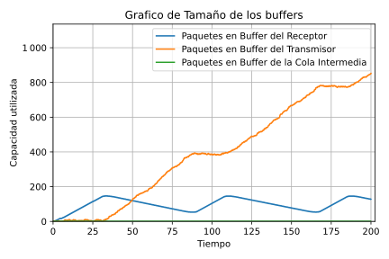 |  |
| ----------------------------------------------------------------------------------- | --------------------------------------------------------------------------------------------- |

| 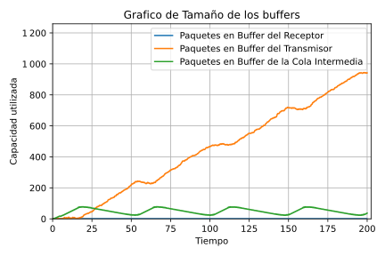 | 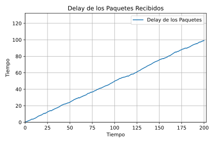 |
| ----------------------------------------------------------------------------------- | --------------------------------------------------------------------------------------------- |

### En el Caso de Estudio 1 se puede notar lo siguiente:

- Receptor: Utiliza su control de flujo ya que va haciendo zig zag, al crecer tanto que llega cerca de un límite se activan las alertas de disminución de velocidad disminuyendo el flujo, pero al decaer se activan las alertas de incremento de velocidad, aumentando el flujo. Esto se repite ciclicamente hasta finalizar la simulación.
- Transmisor: Simplemente tiene un buffer inmenso por lo que el generador estará constantemente enviando paquetes y esté recibiendo.
- Cola Intermedia: Debido a que nunca tiene saturación gracias a sus capacidades altas de transmitir apenas recibe, su capacidad utilizada es de 1 ya que todo lo que llega sale casi instantáneamente.

Lo interesante de este caso es como el algoritmo implementado realizar el Control de Flujo entre el Receptor y Transmisor, lo mas importante es que el Receptor siempre esta ocupado enviando, pero nunca esta en la situación de perdida de paquetes, por lo que para este caso el algoritmo es correcto ante el objetivo de evitar la perdida de paquetes por Receptor con pocos recursos de procesamiento.

### En el Caso de Estudio 2 notamos que:

- Receptor: Nunca tiene saturación gracias a sus capacidades altas de transmitir apenas recibe, su capacidad utilizada es de 1 ya que todo lo que llega sale casi instantáneamente.
- Transmisor: De igual manera que en el Caso de Estudio 1.
- Cola Intermedia: Acá se utiliza su Control de Congestion ya que va haciendo zig zag, al crecer tanto que llega cerca de un límite se activan las alertas de disminución de velocidad disminuyendo el flujo, pero al decaer se activan las alertas de incremento de velocidad, aumentando el flujo.

Analogamente al Caso de Estudio 1, lo interesante de esto es como la Cola Intermedia aplica su Control de Congestion evitando la perdida de paquetes.

Algo importante a mencionar en ambos casos de estudio es que la demora total de los paquetes a través del tiempo es cada vez mayor sin nunca llegar a un limite o reducirse, esto es porque en realidad los paquetes quedan almacenados en el transmisor hasta poder ser enviados, haciendo que realmente los paquetes esperen su turno ahí, por lo que la demora de paquetes siempre crece dado que ese buffer siempre lo hace.

Aclaración: No se incluyeron graficas de Perdida de Paquetes, porque justamente no ocurrieron.

### Casos de estudio 1 (Primera Fila) y 2 (Segunda Fila) con distribución exponencial(λ=0,3):

| Tamaño de buffers | Delay de paquetes |
| ----------------- | ----------------- |

|  |  |
| ----------------------------------------------------------------------------------- | --------------------------------------------------------------------------------------------- |

|  |  |
| ----------------------------------------------------------------------------------- | --------------------------------------------------------------------------------------------- |

### Caso de Estudio 1 y 2:

Similarmente a la Parte 1 con λ >= 0.3, la Red tiene bastante capacidad para la velocidad de transmision dada por esta distribucion, por lo que si bien las capacidades oscilan nunca se activan ninguno de los mecanismos de Control de Congestion ni de Control de Flujo, haciendo que los casos sean identicos a la Parte 1

## Conclusión

Si bien los resultados fueron prometedores, cabe aclarar que las caracteristicas de la Red hacen del problema una version muy simplificada a la realidad, y por ende la solucion planteada es tambien muy simple, se enfoco más en graficar y sacar conclusiones de las metricas obtenidas que de procurar hacer el algoritmo mas sofisticado para resolver el problema. Dentro de las simplificaciones hechas, nuestro algoritmo es incapaz de resolver correctamente el problema ante situaciones como:

- Enrutadores intermedios (o conjunto de) con grandes capacidades pero receptor con muy baja capacidad de buffer. Eso haria que el efecto de reducir la tasa de transmision tome mas tiempo en aplicarse, haciendo que los buffers intermedios envien la totalidad de sus paquetes acumulados causando perdida de paquetes al llenarse el receptor.
- Caida de enrutadores o caminos de red
- Situaciones en las que los problemas pueden estar dados en los enrutadores intermedios y no en el emisor, nuestra solucion es siempre avisar al emisor de reducir el flujo pero en realidad podria ser que los enrutadores reduzcan su flujo.

Pese a esta situaciones, el analisis de las metricas fue muy interesante y sobretodo se aprendio bastante bien a como usar Omnet++

### Referencias

- Tanembaum. Computer Networks: quinta edición del 2011

- TicToc Omnet++
