# Laboratorio 4: Red

## Integrantes:

- Tomas Ponce
- Franco Molina
- Victoria Lopez

## Introducción:

En este laboratorio lo que vemos es el problema de enrutamiento para multiples nodos en la Red.
Esto nos lleva a decidir por qué interfaz se deben enviar los paquetes que le llegan a un nodo ya sea desde la capa de aplicación superior o desde los nodos adjacentes.
El objetivo de este laboratorio es generar un enrutamiento que proporcione una utilizacion eficiente de los recursos de la red y mejore el tiempo de entrega.

En el laboratorio se utilizo una topologia de anillo en el que cada nodo esta conectado por otros dos como muestra en la siguiente imagen

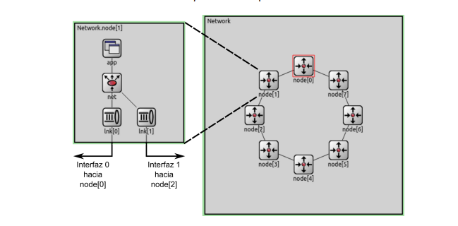

Como se ve en la imagen, cada nodo cuenta con dos capas de enlace, ademas tiene una capa de aplicacion que genera y recibe paquetes.

### Algoritmo base:

No se tiene en cuenta la distancia del enrutador de origen al enrutador del destino, todos los paquetes se envían por la direccion del sentido de las manecillas del reloj. Esto es basicamente ineficiente en ciertos casos dado que si los paquetes fueran enviados por el sentido contrario podrian llegar mas rapido y ocupar menos recursos.

### Algoritmo implementado:

Sabiendo que tenemos una topología en forma de anillo, primero cada nodo envia un paquete con la informacion de dicho nodo para que de la vuelta completa del anillo, de este modo todos los nodos van a saber de dicho nodo. Haciendo esto para todos los nodos entonces todos los nodos van a tener la informacion del resto. Con esto en mente, a medida que un nodo recibe el paquete que contiene la informacion de otro nodo, este actualiza una tabla de enrutamiento interna, que contiene informacion acerca de la distancia (o coste) de enviar un paquete por uno de los lados para cada nodo en la red excepto si mismo. Luego, en el momento de enviar un paquete de datos en base a la informacion de la tabla de enrutamiento y a la cantidad de nodos en la red se determina si se envia el paquete por un lado o el otro, priorizando aquel cuyo coste sea menor. De este modo, el algoritmo envia los paquetes por el camino mas corto posible.

### Caso de Estudio 1:

Nodos emisores: 0 y 2.
Nodos receptores: 5.

| Algoritmo Base                                                                        | Algoritmo implementado                                                                          |
| ------------------------------------------------------------------------------------- | ----------------------------------------------------------------------------------------------- |
| 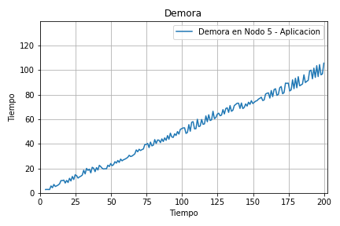                                   | 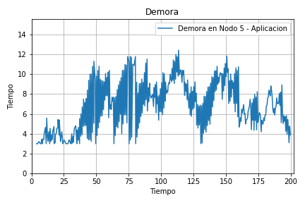                                               |
| ------------------------------------------------------------------------------------- | ----------------------------------------------------------------------------------------------- |
| 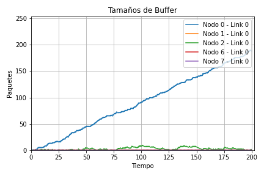             | 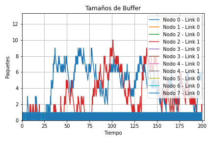                         |

En base a las metricas obtenidas se puede ver como en el algoritmo de base tenemos un tiempo de demora que va incrementandose a traves del timepo, esto se debe a que ambos emisores usan la misma ruta y por ende empiezan a llenar los buffers intermedios, haciendo que se demoren en enviar los paquetes, particularmente se comienza a llenar el buffer del Nodo 0, el cual recibe 2K paquetes (K del Nodo 2 y K de la capa de aplicación) pero solo es capaz de enviar K paquetes en el mismo tiempo. En cambio, en el algoritmo implementado esto no sucede, el tiempo de demora maximo es ~12 y nunca supera dicho valor, esto es porque ambos emisores usan rutas distintas que no tienen nodos en comun, por ende no llenan bufferes intermedios y en particular los nodos intermedios son capaces de reenviar los paquetes al momento en el que llegan.

En el caso de los Tamaños del Buffer, para el algoritmo base se tiene la situacion de que los nodos 0 y 2 comparten nodos intermedios para enviar sus paquetes, particularmente sucede lo descrito anteriormente, el Nodo 0 recibe 2K paquetes (K del Nodo 2 y K de la capa de aplicación) pero es solo capaz de enviar K paquetes en el mismo tiempo y por ende su buffer comienza a llenarse. En cambio, en el algoritmo mejorado esto no sucede, simplemente porque el nodo 0 y 2 usan caminos disjuntos sin llenar los bufferes de ninguno de los nodos.

### Caso de Estudio 2:

Nodos emisores: 0, 1, 2, 3, 4, 6 y 7 (Red sobrecargada)
Nodos receptores: 5

| Algoritmo Base                                                                        | Algoritmo implementado                                                                          |
| ------------------------------------------------------------------------------------- | ----------------------------------------------------------------------------------------------- |
| 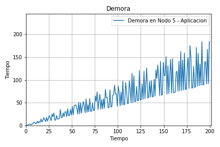                                   | 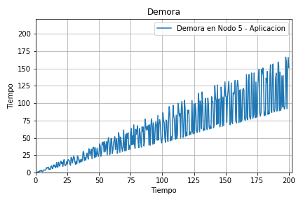                                               |
| ------------------------------------------------------------------------------------- | ----------------------------------------------------------------------------------------------- |
| 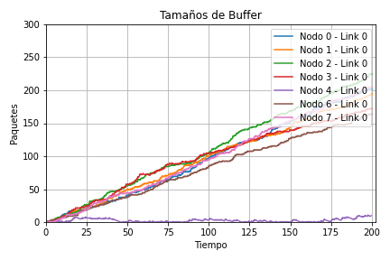             | 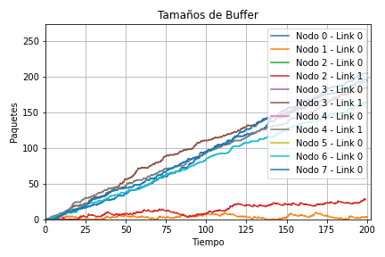                         |

Este caso de estudio es particular, basicamente porque la red esta totalmente sobrecargada y ningun algoritmo de enrutamiento es capaz de solventar eso porque el problema es justamente que hay congestion mas que problemas de enrutamiento. Justamente por esto las metricas son similares, con minimas mejoras en el algoritmo mejorado. La demora es intermitente en un rango por un lado por los buffers que causan demora en la entrega de paquetes (por eso es un rango creciente) y por otro lado porque llegan paquetes lejanos y luego llegan paquetes cercanos, haciendo que la demora registrada salte abruptamente, y por ende se vea como un rango.

### Aprovechamiento para el Caso de Estudio 2

| Algoritmo Base                                                        | Algoritmo implementado                                              |
| --------------------------------------------------------------------- | ------------------------------------------------------------------- |
| 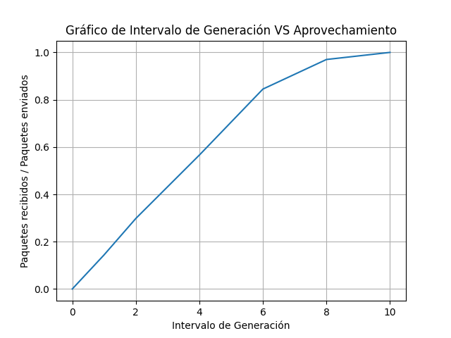 | 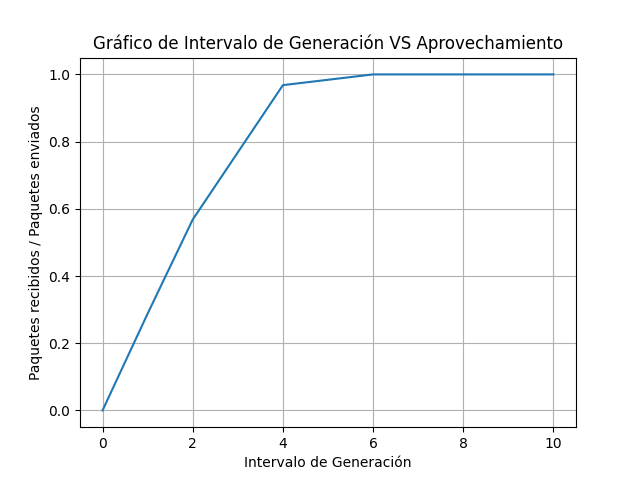 |

Aca comparamos el aprovechamiento de la Red (Paquetes recibidos / Paquetes enviados) en terminos del intervalo de generación dado. Se puede notar claramente de que el algoritmo implementado es basicamente el doble de eficiente que el algoritmo base, si bien no siempre se logra aprovechar el 100% de la Red dado que no soporta tanta carga si sucede que en el caso del algoritmo implementado se reciben hasta aproximadamente 2 veces mas paquetes que en el caso del algoritmo base. Demostrando asi la mejoria por implementar el algoritmo.

### Conclusion

En base a las conclusiones parciales que obtuvimos de analizar los casos de estudios es claro que el algoritmo de enrutamiento aumenta las capacidades de la red en ciertos casos, tal como es visto en el caso de estudio 1. Sin embargo, en otras condiciones pese a tener un mejor enrutamiento se da la situación de que la red no mejora su capacidad, esto es por ejemplo cuando 2 emisores usan el mismo camino y por ende llenan el buffer de alguno de los 2 emisores, la solución a esto podria ser detectar la congestión y usar el camino contrario, que es mas largo pero garantiza mayor velocidad de transmision a coste de un poco mas de demora. Aun asi sirvio para tener una buena idea de como manejar enrutamiento de paquetes.

A modo de apreciación hubiese estado bueno hacer el caso de una red con una topología cualquiera (Punto Estrella). Nosotros no llegamos a hacerlo por otras prioridades de laboratorios y materias pero capaz si el laboratorio se basase en resolver unicamente dicho punto creo que se hubiera podido y hubiera estado muy bueno, sobretodo porque se pueden implementar algoritmos un poco mas complejos y ver como se enruta en esos casos mas generales. De cualquier modo, estuvo interesante hacer la topología anillo.
